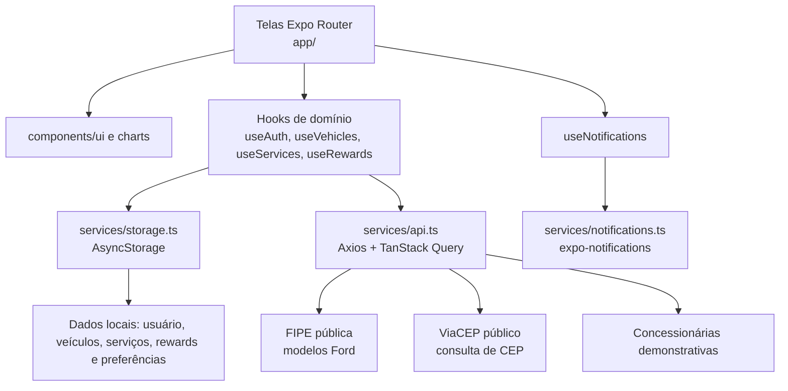

# Arquitetura real

## Fluxo de dados

1. O layout raiz prepara o seed local, carrega fontes e consulta o marcador de onboarding.
2. A tela chama um hook de domínio; o hook lê/grava AsyncStorage e atualiza o estado React.
3. Modelos Ford e concessionárias usam TanStack Query. Somente modelos dependem da FIPE; concessionárias são um catálogo local com atraso simulado.
4. Ao selecionar uma concessionária, a tela consulta ViaCEP para exibir a referência de endereço. A consulta não cria nem confirma agendamento remoto.
5. O agendamento persiste localmente. O lembrete é apenas local e é agendado somente se módulo, dispositivo e permissões permitirem.

## Limites importantes

| Item | Situação real |
| --- | --- |
| Vehicle Health Score e sistemas | valores demonstrativos, não telemetria/diagnóstico real |
| Veículos, serviços, perfil e fidelidade | persistência local em AsyncStorage |
| Concessionárias e disponibilidade | dados demonstrativos, sem agenda corporativa |
| FIPE e ViaCEP | integrações públicas HTTP |
| Notificações | locais; sem push, backend ou garantia no Expo Go Android |
